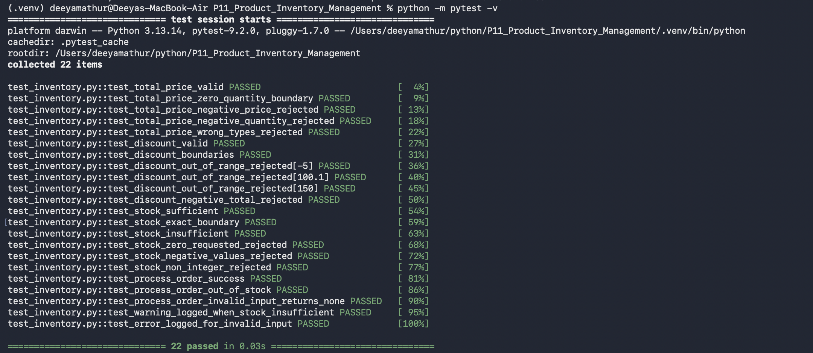
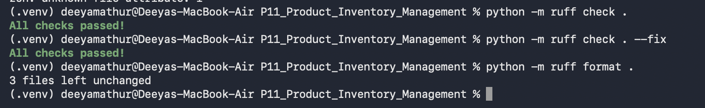

# Product Inventory Management

A Python application that manages product information: it calculates total
price, applies discounts and checks stock availability. It includes input
validation, exception handling, unit tests (pytest), logging to a file and
code-quality checks (Ruff).

## Features Implemented

- `calculate_total_price(price, quantity)` – returns price × quantity; rejects negative or non-numeric price and negative or non-integer quantity.
- `apply_discount(total, discount_percent)` – returns the amount after discount; discount must be between 0 and 100.
- `check_stock(available_stock, requested_quantity)` – returns `True` if the request can be fulfilled, `False` otherwise; rejects negative, zero (requested) or non-integer quantities.
- `process_order(...)` – combines the three checks and handles exceptions so one bad order does not crash the program.
- Exceptions: `TypeError` for wrong types, `ValueError` for out-of-range values.
- Logging to `application.log` (DEBUG, INFO, WARNING, ERROR).
- 22 pytest tests covering valid inputs, boundary conditions and invalid inputs.
- Ruff linting and formatting.

## Project Structure

```
product-inventory-management/
├── inventory.py
├── test_inventory.py
├── README.md
├── .gitignore
└── application.log      # generated when the program runs
```

## macOS Setup

1. Open Terminal (Command + Space, type `Terminal`, press Return).
2. Check Python 3 and pip:

```bash
python3 --version
python3 -m pip --version
```

3. Clone the repository and move into it:

```bash
git clone https://github.com/mathur458/P11_Product_Inventory_Management.git
```

4. Create and activate a virtual environment:

```bash
python3 -m venv .venv
source .venv/bin/activate
```

## Installation

```bash
python -m pip install --upgrade pip
python -m pip install pytest ruff
```

## Execution

```bash
python inventory.py
cat application.log
```

## Testing

```bash
python -m pytest -v
```

## Code Quality (Ruff)

```bash
python -m ruff check .
python -m ruff check . --fix
python -m ruff format .
```

## Logging Levels Used

| Level   | Used for                                              |
| ------- | ----------------------------------------------------- |
| DEBUG   | Inputs received by each function                      |
| INFO    | Successful calculations, stock available, order done  |
| WARNING | Zero quantity, 0% discount, insufficient stock        |
| ERROR   | Invalid inputs and failed orders                      |

## Screenshots

